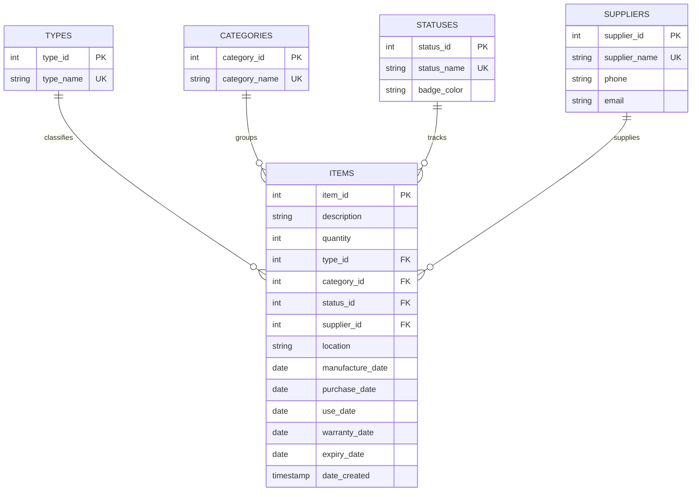

# Inventory Management System

A simple PHP and MySQL web app for tracking goods from the supplier who provides them to the moment they leave the warehouse. Create, view, edit and delete inventory items, and manage the categories, types, statuses and suppliers they belong to.

## Features

- **Items**: add, view, edit and delete inventory items from one page, using pop-up forms and a 3-dot action menu on each row
- **Categories, Types, Statuses and Suppliers**: add and delete entries on their own pages
- **Safe deletes**: a category, type, status or supplier can't be deleted while any item still uses it
- **Coloured status badges**: each status has a badge colour (grey, blue, green, orange or red)
- **Optional dates**: manufacture, purchase, use, warranty and expiry dates can be left empty
- **Sample data**: the SQL file loads starter statuses, types, categories and a demo supplier
- **Safer queries**: all database queries use prepared statements, and page output is escaped

## Tech stack

- PHP 7 or newer (MySQLi)
- MySQL / MariaDB
- HTML, CSS and a little vanilla JavaScript
- Local server: [MAMP](https://www.mamp.info/)

## Database design



Every item belongs to exactly one type, category, status and supplier. Each of those can have many items.

## Project structure

| File | What it does |
|---|---|
| `index.php` | Home page with cards linking to each section |
| `items.php` | Add, view, edit and delete items |
| `categories.php` | Settings for the Categories page |
| `types.php` | Settings for the Types page |
| `statuses.php` | Settings for the Status page |
| `suppliers.php` | Settings for the Suppliers page |
| `list_page.php` | Shared page engine used by the four pages above |
| `nav.php` | Top navigation bar |
| `database.php` | Database connection |
| `database.sql` | Creates the database, tables and sample data |
| `style.css` | Styling for the whole app |

The four list pages (`categories.php`, `types.php`, `statuses.php`, `suppliers.php`) only set a few variables (`$title`, `$singular`, `$table`, `$idcol`, `$fields`) and then include `list_page.php`. To add another lookup table, copy one of them and change those values.

## Getting started (Mac with MAMP)

### 1. Install and start MAMP

Download MAMP, open it and click **Start**, so both Apache and MySQL are running.

### 2. Get the code

Clone the repo into MAMP's web folder:

```bash
cd /Applications/MAMP/htdocs
git clone <your-repo-url> inventory
```

### 3. Create the database

1. Open phpMyAdmin from the MAMP start page (usually `http://localhost:8888/phpMyAdmin`).
2. Click the **Import** tab.
3. Choose `database.sql` from the project folder and click **Import**.

This creates a database called `inventory_db`, all five tables and the sample data.

### 4. Check the connection settings

Open `database.php`. The defaults match MAMP:

```php
$host = "localhost";
$user = "root";
$password = "root";
$database = "inventory_db";
```

If your MySQL username or password is different, change them here.

### 5. Open the app

Go to [http://localhost:8888/inventory/](http://localhost:8888/inventory/). If you changed MAMP's Apache port to 80, use `http://localhost/inventory/` instead.

## How to use it

1. Open **Categories**, **Types**, **Status** and **Suppliers** and add anything you need. Sample entries are already loaded.
2. Open **Items** and click **+ Add Item**.
3. Use the 3-dot menu on any item row to **View**, **Edit** or **Delete** it.

## Notes

- Names of categories, types, statuses and suppliers must be unique.
- The default `root` / `root` login is only suitable for local development. Don't use it on a public server.
- Lookup entries (categories, types, statuses, suppliers) can be added and deleted, but not edited.
